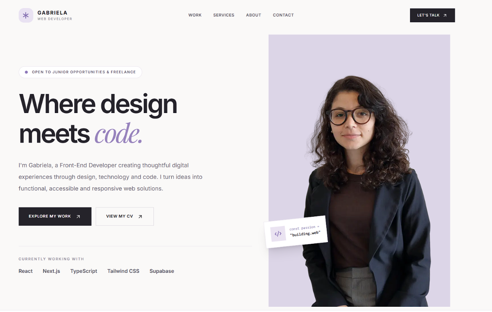

# Gabi de Souza - Portfolio

A modern, responsive portfolio website built with Next.js, showcasing my work as a Front-End Developer.



## 🚀 Tech Stack

- **Framework**: Next.js 15 (App Router)
- **Language**: TypeScript
- **Styling**: Tailwind CSS
- **UI Components**: shadcn/ui
- **Icons**: Lucide React & React Icons
- **Fonts**: Inter & Playfair Display (Google Fonts)
- **Email Service**: Resend

## ✨ Features

- **Responsive Design**: Optimized for all screen sizes
- **Modern UI**: Clean, elegant interface with smooth animations
- **Project Showcase**: Interactive project cards with links to live sites
- **Contact Form**: Functional form with email integration
- **Dark Mode Ready**: Color system supporting light/dark themes
- **SEO Optimized**: Proper meta tags and semantic HTML

## 📁 Project Structure

```
meu-portfolio/
├── src/
│   ├── app/
│   │   ├── api/contact/     # Contact form API route
│   │   ├── globals.css      # Global styles
│   │   ├── layout.tsx       # Root layout
│   │   └── page.tsx         # Main portfolio page
│   └── components/
│       └── ui/              # Reusable UI components
├── public/
│   ├── images/             # Project images
│   └── social.png          # Social media preview image
└── README.md
```

## 🛠️ Getting Started

1. Clone the repository:
```bash
git clone https://github.com/GabrielaSouz/Portfolio.git
cd Portfolio
```

2. Install dependencies:
```bash
npm install
```

3. Set up environment variables:
Create a `.env.local` file with:
```
RESEND_API_KEY=your_resend_api_key
DESTINATION_EMAIL=your_email@example.com
FROM_EMAIL=noreply@yourdomain.com
FROM_NAME=Gabi de Souza
```

4. Run the development server:
```bash
npm run dev
```

5. Open [http://localhost:3000](http://localhost:3000) in your browser

## 📦 Build for Production

```bash
npm run build
npm start
```

## 🌐 Deployment

This project is deployed on Vercel. To deploy your own:

[](https://vercel.com/new?utm_source=portfolio-template&utm_medium=repository)

## 📧 Contact

- **Email**: souza.gab@hotmail.com
- **GitHub**: [GabrielaSouz](https://github.com/GabrielaSouz)
- **LinkedIn**: [Gabriela de Souza](https://www.linkedin.com/in/gabriela-de-souza-0a6847161/)

## 📄 License

This project is open source and available under the MIT License.

---

Built with ❤️ by Gabi de Souza
